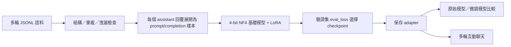

# NLP_HW-多輪對話

以 **Qwen2.5-1.5B-Instruct** 為基礎，使用 **QLoRA（4-bit NF4 + LoRA）**，在 Windows 本機微調臺灣繁體中文「土味情話接話教練」。

使用者向模型請教如何開口，再帶入對方可能的回應追問；模型提供可直接使用的台詞，並延續前文。專案包含多輪語料、資料驗證、兩版微調、微調前後比較，以及終端機互動聊天。

- [資料與格式](#資料與格式)
- [環境與安裝](#環境與安裝)
- [驗證與預覽](#驗證與預覽)
- [訓練方法](#訓練方法)
- [實驗結果](#實驗結果)
- [微調前後比較](#微調前後比較)
- [互動聊天](#互動聊天)
- [限制與後續改善](#限制與後續改善)

## 專案狀態

| 項目 | 目前狀態 |
| --- | --- |
| 基礎語料 | 200 筆訓練對話、20 筆驗證對話 |
| 增強語料 | 500 筆訓練對話；與基礎版共用 20 筆驗證對話 |
| 保留測試情境 | 10 組，每組 3 個使用者提示與人工檢核點 |
| 微調 | 本機已留下兩版完整 3 epochs 的 checkpoint 記錄與 final adapter |
| 比較與聊天 | 已有比較報告與 `chat.py` |
| GitHub 內容 | 程式、語料、設定與輕量報告；模型權重及 adapter 不隨 repository 提供 |

這份 README 依現有程式、資料檔與 Trainer 記錄整理。數值結果可查閱 [training_metrics.json](reports/training_metrics.json)，資料統計可查閱 [data_statistics.json](reports/data_statistics.json)。

## 專案流程



## 檔案結構

```text
NLP_HW-MultiTurnDialogue/
├─ README.md
├─ requirements.txt
├─ .gitignore
├─ data/
│  ├─ train.jsonl                 # 基礎版：200 筆對話
│  ├─ train_v2.jsonl              # 增強版：500 筆對話
│  ├─ eval.jsonl                  # 20 筆驗證對話
│  └─ test_scenarios.jsonl        # 10 組保留測試情境
├─ models/
│  └─ README.md                   # 基礎模型下載與放置說明
├─ reports/
│  ├─ training_metrics.json
│  ├─ data_statistics.json
│  ├─ environment.json
│  ├─ validation_base.json
│  ├─ validation_v2.json
│  ├─ base_vs_qlora_zhTW.json
│  └─ base_vs_qlora_zhTW.md
├─ validate_data.py
├─ test_validate_data.py
├─ preview_data.py
├─ check_qlora.py
├─ train_qlora.py
├─ train_qlora_v2.py
├─ evaluate_qlora.py
└─ chat.py
```

在本機執行訓練後，另會產生 `outputs/qlora/`、`outputs/qlora_v2/` 與各自的 `final_adapter/`。這些大型產物已由 `.gitignore` 排除；clone 後不會自動擁有微調權重。

## 資料與格式

### 角色設定

訓練與驗證資料皆以以下 system 開頭：

```text
你是一個土味情話高手，會使用繁體中文，以親切、溫和、幽默的口吻回答，能延續前文接梗，並尊重對方意願。
```

- `system`：設定繁體中文、語氣與接話原則。
- `user`：向情話教練請教，後續提供對方可能的反應。
- `assistant`：提供可用台詞；遇到明確拒絕時尊重收尾。

每筆至少兩輪完整 `user → assistant` 問答，並以真正的訊息陣列儲存。整段兩人劇本不會被塞進單一 assistant 訊息。

### 資料量

| 檔案 | 對話／情境數 | 2 輪對話 | 3 輪對話 | 展開後的 assistant 訓練目標數 |
| --- | ---: | ---: | ---: | ---: |
| `train.jsonl` | 200 | 96 | 104 | 504 |
| `train_v2.jsonl` | 500 | 276 | 224 | 1,224 |
| `eval.jsonl` | 20 | 18 | 2 | 42 |
| `test_scenarios.jsonl` | 10 組 | — | 每組 3 個使用者提示 | 不作為訓練資料 |

`train.jsonl` 與 `train_v2.jsonl` 是兩個實驗版本，使用其中一份訓練即可。不要把兩份直接合併後，仍把筆數當成互不重複的 700 筆。

### JSONL 範例

每行是一個 UTF-8 JSON 物件。以下為方便閱讀而展開的兩輪格式示例：

```json
{
  "id": "example-hotpot",
  "category": "火鍋邀約",
  "messages": [
    {"role": "system", "content": "你是一個土味情話高手，會使用繁體中文，以親切、溫和、幽默的口吻回答，能延續前文接梗，並尊重對方意願。"},
    {"role": "user", "content": "想約喜歡的人吃火鍋，怎麼開口？"},
    {"role": "assistant", "content": "你可以說：「我知道這一家火鍋少了一樣東西，想請妳幫忙。」"},
    {"role": "user", "content": "她問少什麼呢？"},
    {"role": "assistant", "content": "你就接：「少了坐在我對面的妳。這週有空一起吃嗎？」"}
  ]
}
```

保留測試採用 `first_user`、`follow_up_user`、`third_user` 與 `checks`，不含標準 assistant 答案。它的結構與訓練集不同。

### 資料驗證現況

- **基礎版**：200/20/10 的結構、角色、system、輪數與嚴格字面重複檢查通過，0 errors、0 warnings。
- **增強版**：500 筆對話沒有結構錯誤；嚴格模式有 **864 則重複問句或字面近似警告**，因此 `ok: false`。864 是警告數，並非 864 筆資料。
- 本次增強版檢查沒有跨 train/eval 或保留測試的字面比對警告；這仍不能證明語意完全獨立。

增強版保留目前實驗使用的內容，沒有為了讓報告通過而自動刪改。完整診斷見 [基礎版驗證](reports/validation_base.json) 與 [增強版驗證](reports/validation_v2.json)。字面檢查也無法自動判定笑點、語句自然度或全球原創性。

## 環境與安裝

### 本機實驗環境

| 元件 | 記錄版本／規格 |
| --- | --- |
| 作業系統 | Windows、PowerShell |
| Python | 3.12.10 |
| GPU | NVIDIA GeForce RTX 5070 Ti Laptop GPU，約 11.91 GiB VRAM |
| PyTorch | 2.14.1+cu130 |
| Transformers | 5.20.2 |
| TRL | 1.16.0 |
| PEFT | 0.21.2 |
| bitsandbytes | 0.50.2 |
| datasets | 5.1.0 |
| accelerate | 1.15.0 |
| OpenCC | opencc-python-reimplemented 0.1.7 |

詳細版本見 [environment.json](reports/environment.json)。這是既有環境的紀錄，不代表其他顯卡、驅動或所有作業系統都已測試。

### 1. 取得程式

```powershell
git clone https://github.com/queena17chao/NLP_HW-MultiTurnDialogue.git
Set-Location -LiteralPath '.\NLP_HW-MultiTurnDialogue'
```

### 2. 準備 Python 環境

已有可用的原專案 `.venv` 時，直接使用現有環境。以下建立步驟供新環境使用：

```powershell
py -3.12 -m venv .venv
```

先依 [PyTorch 官方安裝頁](https://pytorch.org/get-started/locally/) 選擇 Windows、Python 與合適的 CUDA build，使用 `.venv\Scripts\python.exe -m pip` 執行官方提供的安裝命令，再安裝其餘套件：

```powershell
.\.venv\Scripts\python.exe -m pip install -r requirements.txt
.\.venv\Scripts\python.exe -c "import torch; print(torch.__version__); print(torch.cuda.is_available()); print(torch.cuda.get_device_name(0) if torch.cuda.is_available() else 'CUDA unavailable')"
```

`requirements.txt` 記錄非 PyTorch 套件版本；PyTorch 另行處理，避免在選擇 CUDA build 前誤裝不符需求的版本。套件是否能取得及驅動相容性，仍須依官方發行來源核對。

### 3. 放置基礎模型

本專案預設從本機載入 [Qwen/Qwen2.5-1.5B-Instruct](https://huggingface.co/Qwen/Qwen2.5-1.5B-Instruct)，預期路徑：

```text
models/Qwen2.5-1.5B-Instruct/
```

新環境可在專案根目錄下載一次：

```powershell
.\.venv\Scripts\python.exe -c "from huggingface_hub import snapshot_download; snapshot_download(repo_id='Qwen/Qwen2.5-1.5B-Instruct', local_dir='models/Qwen2.5-1.5B-Instruct')"
```

下載完成後，目錄應包含 config、tokenizer 與 safetensors 權重檔。訓練和推論程式均使用 `local_files_only=True`；缺少本機模型時不會自動代為下載。

## 驗證與預覽

先在專案根目錄執行基礎版檢查：

```powershell
.\.venv\Scripts\python.exe -X utf8 -B .\validate_data.py --require-system --min-rounds 2 --strict-near
.\.venv\Scripts\python.exe -X utf8 -B .\test_validate_data.py
.\.venv\Scripts\python.exe -X utf8 -B .\preview_data.py
```

`test_validate_data.py` 附有 12 項驗證器測試。`preview_data.py` 會印出第一筆 Qwen 聊天格式與基礎版 train/eval token 長度，不載入模型權重。

增強版使用以下命令；目前會回報前述警告，嚴格模式的非零結束碼是資料檢查結果：

```powershell
.\.venv\Scripts\python.exe -X utf8 -B .\validate_data.py --train .\data\train_v2.jsonl --expected-train 500 --require-system --min-rounds 2 --strict-near
```

驗證器會檢查 JSONL 解析、角色交替、最少輪數、非空內容、重複及跨集合字面洩漏。訓練程式本身不會自動呼叫這個驗證器，需先手動完成檢查。

## 訓練方法

### 多輪對話如何成為訓練樣本

`load_conversations()` 會遍歷每筆對話：遇到 assistant，就把前面的完整歷史保存成 `prompt`，把當次回答保存成 `completion`。

因此兩輪對話會產生兩筆樣本、三輪會產生三筆。模型能看見先前上下文，而 `completion_only_loss=True` 只以當次 completion 計算 loss；每輪 assistant 都各自成為一次學習目標。

### 現有兩版共用設定

| 設定 | 值 |
| --- | --- |
| 基礎模型 | Qwen2.5-1.5B-Instruct |
| 量化 | 4-bit NF4、double quant |
| 運算精度 | 支援時 BF16，否則 FP16 |
| LoRA rank / alpha | 16 / 32 |
| LoRA dropout | 0.05 |
| target_modules | all-linear；已保存設定列出七類投影層 |
| epochs | 3 |
| train / eval batch size | 1 / 1 |
| gradient accumulation | 4 |
| learning rate | 2e-4 |
| optimizer | adamw_torch |
| 最大長度 | 512 tokens |
| packing | False |
| gradient checkpointing | True，use_reentrant=False |
| 驗證與保存 | 每 epoch 一次 |
| 最佳模型選擇 | 最低 eval_loss |
| seed | 42 |

本表描述目前 repository 內實際使用的腳本。前期檢查曾採用的 rank-8 候選設定，與後來完成訓練的 rank-16 設定不同。

### 執行訓練

> **以下命令會真正更新 LoRA 參數。** 目前 `train_qlora.py`、`train_qlora_v2.py` 和 `check_qlora.py` 都沒有 `--train` 保護旗標；直接執行會進入訓練。`--smoke-test` 也會實際訓練 2 steps。

基礎版（200 筆對話，展開 504 筆樣本）：

```powershell
.\.venv\Scripts\python.exe -X utf8 -B .\train_qlora.py --smoke-test
.\.venv\Scripts\python.exe -X utf8 -B .\train_qlora.py
```

增強版（500 筆對話，展開 1,224 筆樣本）：

```powershell
.\.venv\Scripts\python.exe -X utf8 -B .\train_qlora_v2.py --smoke-test
.\.venv\Scripts\python.exe -X utf8 -B .\train_qlora_v2.py
```

這兩組是可選的實驗路徑，並非必須連續重跑所有命令。增強版在重新實驗前宜先處理重複與近似資料。

輸出位置：

| 版本 | 正式輸出 | 短測輸出 |
| --- | --- | --- |
| 基礎版 | `outputs/qlora/` | `outputs/smoke_test/` |
| 增強版 | `outputs/qlora_v2/` | `outputs/smoke_test_v2/` |

正式訓練會依驗證 loss 回載最佳 checkpoint，再把 adapter 與 tokenizer 存入 `final_adapter/`。短測不會建立正式的 final adapter。重新執行正式訓練前，請使用另一份專案副本或調整腳本的 `output_dir`，保留既有結果。

## 實驗結果

以下直接取自本機 `trainer_state.json`，沒有在整理 repository 時重新訓練。

| 版本 | 訓練對話 | 展開樣本 | Epoch 1 eval_loss | Epoch 2 eval_loss | Epoch 3 eval_loss | 最佳 checkpoint | 總更新步數 |
| --- | ---: | ---: | ---: | ---: | ---: | --- | ---: |
| 基礎版 | 200 | 504 | 2.156126 | 2.180681 | 2.526691 | checkpoint-126 | 378 |
| 增強版 | 500 | 1,224 | 2.113292 | 2.189831 | 2.482412 | checkpoint-306 | 918 |

兩版最佳 checkpoint 都出現在第一個 epoch，後續驗證 loss 上升，提示過擬合風險。增強版的最低 eval_loss 稍低，但不能僅據此斷言它更幽默或更會接話；仍須比較實際多輪回答。

資料品質、生成自然度與角色一致性需另外檢核。`mean_token_accuracy` 是 token 預測指標，不應寫成情話品質或使用者滿意度百分比。

## 微調前後比較

既有比較報告：

- [逐輪閱讀版](reports/base_vs_qlora_zhTW.md)
- [JSON 結果](reports/base_vs_qlora_zhTW.json)

`evaluate_qlora.py` 先執行原始模型，再載入 adapter，兩者各自累積自己的對話歷史。測試使用 10 組、每組 3 輪的保留提示。

先確認有對應 adapter，再執行：

```powershell
.\.venv\Scripts\python.exe -X utf8 -B .\evaluate_qlora.py --limit 1
.\.venv\Scripts\python.exe -X utf8 -B .\evaluate_qlora.py
```

目前程式預設讀 `outputs/qlora/final_adapter`，結果寫至 `outputs/evaluation/`。`--limit 1` 只評估一組；不加參數才評估全部 10 組。

報告中的人工檢核方框尚未填寫，沒有完成的人工作答分數或自動品質總分。既有 JSON 也未記錄 adapter 雜湊，無法僅憑報告檔名嚴格追溯模型版本；重新評估時應另存版本資訊。

這些測試已被用於既有比較；若再依其結果修訂訓練資料，後續需增加未曾用來調整模型的新測試情境。

## 互動聊天

確認基礎模型與已訓練 adapter 都存在後：

```powershell
.\.venv\Scripts\python.exe -X utf8 -B .\chat.py
```

可用指令：

| 輸入 | 功能 |
| --- | --- |
| 一般問題 | 送出問題並保留前文 |
| `/reset` | 清除目前對話歷史 |
| `/exit` | 結束程式 |

聊天程式保留近期完整對話輪次；超過 2,048 個輸入 tokens 時移除最早的一輪。目前生成使用 `do_sample=False`、最多 128 個新 tokens。OpenCC 的 `s2twp` 轉換用於臺灣繁體中文輸出；繁體轉換不代表語意品質已被驗證。

### 改用增強版 adapter

`chat.py` 與 `evaluate_qlora.py` 目前預設都是基礎版。若要使用增強版，將兩支程式內的設定改為：

```python
ADAPTER_PATH = ROOT / "outputs" / "qlora_v2" / "final_adapter"
```

並把 `evaluate_qlora.py` 的輸出目錄改為另一個版本資料夾，避免覆蓋既有比較：

```python
OUTPUT_DIR = ROOT / "outputs" / "evaluation_v2"
```

GitHub 沒有附 adapter 權重；須先在本機完成訓練，或取得相同基礎模型所對應的 adapter，才能執行聊天與 adapter 比較。

## 常見問題

### PowerShell 說無法辨識 `import` 或 `from`

Python 語法要放在 `.py` 檔，再用 Python 執行；不要直接貼進 PowerShell。README 的 PowerShell 區塊才是終端機指令。

### `triton not found; flop counting will not work for triton kernels`

既有環境會在匯入 PyTorch 相關模組時出現此 FLOP 統計提示。原始程式來源位於 `torch/utils/flop_counter.py`；該提示與後續發生的實際例外需分開判讀。既有載入檢查與兩版訓練記錄已成功產生，不必只因這一行就重裝整套套件。

### 找不到模型或 adapter

確認 `models/Qwen2.5-1.5B-Instruct/` 包含完整模型檔，以及選用版本的 `final_adapter/` 中有 `adapter_config.json` 與 `adapter_model.safetensors`。clone 本 repository 不會取得這些大型產物。

### CUDA 記憶體不足

先停止其他占用 GPU 的程式，確認沒有另一個模型程序仍在執行，再檢查 batch、序列長度與 gradient checkpointing 設定。前向檢查的記憶體用量不能當成正式反向傳播的峰值；此 repository 未附可核對的完整訓練 VRAM 日誌。

## 限制與後續改善

1. 500 筆增強語料仍有大量重複或近似警告，需先去重與重新檢閱情境承接。
2. 土味情話與「接得自然」具主觀性；低 loss 不足以保證對話品質。
3. 目前只有 20 筆驗證對話，樣本有限；後續宜擴充獨立情境與人工評分。
4. 既有比較可看到教練口吻較集中，但部分回答仍有跳題或泛化問題；報告未完成逐項人工評分。
5. 兩版訓練的最佳驗證表現皆出現在第一個 epoch，可再評估較少 epochs、早停與語料品質改善。
6. 目前主要測試 Windows、單張 NVIDIA GPU 與本 README 列出的環境，未驗證其他平台。
7. 語料由 AI 協助生成與逐輪修訂，參考內容作為風格與接話結構依據；不能保證每句都從未出現在其他來源。

## 參考與授權

- [Qwen2.5-1.5B-Instruct 官方模型頁](https://huggingface.co/Qwen/Qwen2.5-1.5B-Instruct)：基礎模型與官方使用說明；模型頁標示 Apache-2.0。
- [PyTorch 官方安裝說明](https://pytorch.org/get-started/locally/)
- [TRL SFTTrainer 官方文件](https://huggingface.co/docs/trl/sft_trainer)
- [PEFT 官方文件](https://huggingface.co/docs/peft/)
- [QLoRA 論文](https://arxiv.org/abs/2305.14314)
- [使用者提供的情話風格參考](https://www.womenshealthmag.com/tw/mental/sex/a65548398/202552ta/)
- [使用者提供的接話結構參考](https://chatgpt.com/share/6adb6356-9e1c-83e8-9019-6824bfc0361c)

本 repository 目前未另外指定程式與語料的 LICENSE；如需再利用，請先向作者確認授權。基礎模型與第三方套件各依原有授權條款使用。
